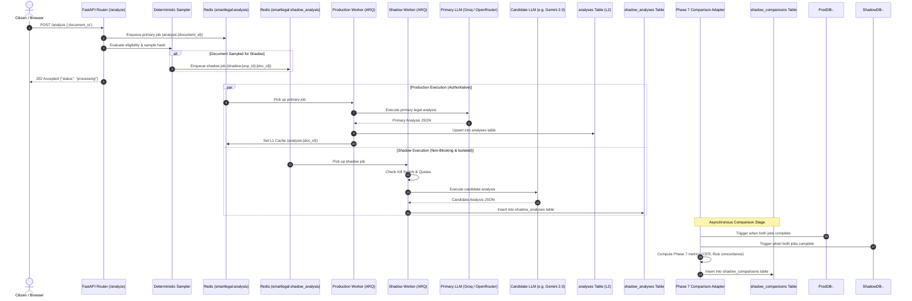

# SmartLegal-AI — Phase 9 Implementation Plan v1.0
## Shadow Execution & Staged Rollout Architecture

**Document ID**: `SL-PLAN-PHASE9-V1.0`  
**Status**: `PHASE 9 PLAN STATUS: READY FOR REVIEW — IMPLEMENTATION NOT AUTHORIZED`  
**Date**: `2026-09-24`  
**Author**: Core AI & Systems Architecture Team  
**Frozen Dependencies**: Phases 1 through 8 (Strictly Frozen & Verified)  
**Target Scope**: Production-Parallel Shadow Pipeline, Deterministic Traffic Sampling, Candidate Provider Isolation, Phase 7 Offline Evaluation Adapter, Multi-Tenant Privacy, Multi-Tier Kill Switch, Staged Canary Rollout  

---

## Table of Contents

1. [Repository Audit & Baseline Architecture](#1-repository-audit--baseline-architecture)
2. [Exact Purpose of Phase 9: Shadow Execution vs. Staged Rollout](#2-exact-purpose-of-phase-9)
3. [Phase 9 Architecture & Data-Flow Design](#3-phase-9-architecture--data-flow-design)
4. [Strict Production Safety Invariants](#4-strict-production-safety-invariants)
5. [Traffic & Rollout Controls Configuration](#5-traffic--rollout-controls-configuration)
6. [Deterministic Sampling Engine](#6-deterministic-sampling-engine)
7. [Candidate Model & Provider Isolation Analysis](#7-candidate-model--provider-isolation-analysis)
8. [Phase 7 Accuracy Evaluation Integration](#8-phase-7-accuracy-evaluation-integration)
9. [Dedicated Shadow Result Schema](#9-dedicated-shadow-result-schema)
10. [Data Retention, Privacy & PII Protection](#10-data-retention-privacy--pii-protection)
11. [Deterministic Failure Taxonomy](#11-deterministic-failure-taxonomy)
12. [Canary Staged Rollout Strategy](#12-canary-staged-rollout-strategy)
13. [Automated Rollback Engine & Circuit Breakers](#13-automated-rollback-engine--circuit-breakers)
14. [Observability, Telemetry & Structured Logging](#14-observability-telemetry--structured-logging)
15. [Concurrency & Resource Protection](#15-concurrency--resource-protection)
16. [Frontend Boundary & Zero Citizen Exposure](#16-frontend-boundary--zero-citizen-exposure)
17. [Security Threat Model (12 Threats Analysis)](#17-security-threat-model)
18. [Multi-Tenant Isolation & Access Control](#18-multi-tenant-isolation--access-control)
19. [Comprehensive Testing Strategy (Unit, Integration, Security, Load, Rollback)](#19-comprehensive-testing-strategy)
20. [Acceptance Criteria](#20-acceptance-criteria)
21. [Phase 9 Sub-Phases Decomposition (9A through 9M)](#21-phase-9-sub-phases-decomposition)
22. [Frozen Phase Protection & Re-Authorization Triggers](#22-frozen-phase-protection--re-authorization-triggers)
23. [Open Architectural Questions](#23-open-architectural-questions)
24. [Implementation Authorization Gate](#24-implementation-authorization-gate)

---

## 1. Repository Audit & Baseline Architecture

The SmartLegal-AI repository was audited in detail across all subsystems to ensure the Phase 9 design builds upon actual production foundations rather than outdated assumptions:

### A. Subsystem Inspection Matrix

| Subsystem | Existing Production Codebase | Key Contracts & Architecture | Phase 9 Integration Requirement |
|---|---|---|---|
| **Analysis API** | `backend/routers/analyze.py` | `POST /analyze` (returns HTTP 202 `{ status: "processing" }`); `GET /analyze/{id}/status` (polls Redis L1 -> DB L2, returns `processing`, `done`, `error`). | Enqueue shadow tasks out-of-band; zero modifications to polling contracts. |
| **Worker / Queue** | `backend/worker.py` | ARQ job runner (`smartlegal:analysis`), job ID `analysis:{document_id}`, 600s hard timeout. Fallback to in-memory task when Redis is unconfigured. | Create dedicated queue `smartlegal:shadow_analysis`; never mix shadow jobs into primary queue. |
| **Database** | `backend/database.py` | Supabase PostgreSQL asyncpg pool with SQLite local fallback. `analyses` table has strict `document_id UNIQUE` constraint. | Must NOT write shadow analyses to `analyses`. Requires dedicated `shadow_analyses` table. |
| **Redis Cache** | `backend/cache.py` | Keys: `analysis:{document_id}` (24h TTL), `doctext:{document_id}` (24h TTL), `budget:cooldown:{provider}`. | Namespace shadow keys strictly under `shadow:*`. Zero shadow writes to `analysis:*`. |
| **AI Providers** | `backend/services/groq_service.py`, `openrouter_service.py` | Groq `llama-3.3-70b-versatile` with automatic OpenRouter fallback. Schema validation via `validate_analysis`. | Execute candidate models (e.g. Gemini 2.0 Flash) through isolated clients. |
| **Budget Manager** | `backend/services/provider_budget_manager.py` | Sliding-window RPM/TPM tracking, cooldown locks (60s), rate-limit header parsing. | Establish separate shadow budget allocation to prevent starving production quotas. |
| **Document Optimizer** | `backend/services/adaptive_optimizer.py` | Phase 6 adaptive compression, page splitting, scratch directory `tempfile.gettempdir()/sl_opt_*`. | Operate on read-only original bytes; scratch paths isolated to `tempfile.gettempdir()/sl_shadow_*`. |
| **Evaluation Suite** | `backend/evaluation/` (`runner.py`, `comparative.py`, `metrics.py`) | Offline synthetic evaluation harness, schema v7.1. Evaluates CER, WER, SequenceMatcher, risk concordance. | Pure functional import for comparison diffing. Evaluation metrics never exposed to UI. |
| **Frontend UI** | `frontend/src/` (`Analysis.tsx`, `analysisSlice.ts`) | 7-state Redux machine (`queued`, `processing`, `completed`, `completed_with_uncertainty`, `partial`, `failed`, `provider_unavailable / retrying_provider`). | Strictly frozen. Zero citizen-facing exposure of shadow runs. |

### B. Current Baseline Test Health
- **Full Backend Regression Suite**: **368 / 368 passing** (0 failures).
- **Dedicated Frozen Suites (Phases 1–7)**: **214 / 214 passing** (0 failures).
- **Frontend Confidence UX Suite (Phase 8)**: **20 / 20 passing** (0 failures).
- **Frontend Production Build**: **`npm run build` succeeds in 6.84s with 0 errors**.

---

## 2. Exact Purpose of Phase 9

Phase 9 introduces an enterprise-grade evaluation mechanism to safely benchmark and roll out candidate LLMs, prompts, or extraction pipelines without citizen risk.

```
┌────────────────────────────────────────────────────────────────────────┐
│                        PHASE 9 OPERATIONAL SPLIT                       │
├───────────────────────────────────┬────────────────────────────────────┤
│ 1. SHADOW EXECUTION (Evaluation)  │ 2. STAGED ROLLOUT (Canary)         │
├───────────────────────────────────┼────────────────────────────────────┤
│ Runs in background on sample data │ Serves candidate output to users   │
│ Output: Stored in shadow tables   │ Output: Stored in production table │
│ Impact on user: ZERO (100% blind) │ Impact on user: Governed by gate   │
│ Client response: Primary only     │ Client response: Candidate result  │
│ Failure impact: Silently dropped  │ Failure impact: Standard fallback  │
│ Goal: Parity & safety validation  │ Goal: Zero-downtime model cutover  │
└───────────────────────────────────┴────────────────────────────────────┘
```

### A. Shadow Execution (Phase 9 Primary Focus)
A secondary/candidate analysis executes concurrently with or following the primary production analysis.
- **MUST NOT** replace or overwrite the primary analysis result.
- **MUST NOT** affect the user's displayed legal analysis or clause breakdown.
- **MUST NOT** alter document status in the `documents` table.
- **MUST NOT** trigger user-facing errors, warnings, or toasts.
- **MUST NOT** trigger automated Advocate escalation (`LawyerEscalationModal`).
- **MUST NOT** alter production provider fallback states or cooldown locks.
- **MUST NOT** influence production routing decisions.

### B. Staged Rollout (Canary Traffic Shift)
Only after an extensive shadow evaluation run achieves statistical parity and safety sign-off does the system begin shifting user-facing traffic.
- Governed by explicit canary percentages (e.g. 1%, 5%, 25%, 50%, 100%).
- Backed by automated health circuit breakers that instantaneously roll back to the primary baseline upon the slightest regression.

---

## 3. Phase 9 Architecture & Data-Flow Design



### Architectural Data-Flow Boundaries:
1. **Input Duplication**: The shadow pipeline receives a read-only snapshot of the document's file bytes and metadata. It never modifies the original document on disk.
2. **Shared Data (Read-Only)**: `documents` metadata (file size, mime type, document type) and `doctext:{document_id}` (cached PyMuPDF text, avoiding duplicate text extraction).
3. **Isolated Data (Write-Only)**: Shadow outputs write exclusively to `shadow_analyses` and `shadow_comparisons`. Scratch files write to `/tmp/sl_shadow_*`.
4. **Correlation**: Primary and shadow runs correlate through `(experiment_id, document_id, primary_analysis_id)`.

---

## 4. Strict Production Safety Invariants

The Phase 9 design is governed by seven non-negotiable safety invariants:

1. **Production Result Invariant**: The citizen's analysis result MUST originate exclusively from the primary pipeline unless an explicit, operator-authorized canary stage is active.
2. **Shadow Isolation Invariant**: A failure, unhandled exception, crash, or timeout in shadow execution MUST NEVER fail or delay the production analysis job.
3. **Provider Isolation Invariant**: Shadow API calls MUST NOT consume production Groq/OpenRouter token quotas, trip production cooldown locks, or influence production circuit breakers.
4. **Database Isolation Invariant**: Shadow results MUST NOT be written to `analyses` or `analysis_jobs`. The unique constraint `analyses.document_id UNIQUE` must remain pristine.
5. **User Isolation Invariant**: Under no circumstance shall candidate model outputs, shadow latency, or shadow error messages be returned by `GET /analyze/{id}/status` or displayed in the frontend.
6. **Retry Isolation Invariant**: A shadow job failure shall never trigger worker retries that enqueue duplicate production analysis jobs.
7. **Cost Control Invariant**: Shadow execution must enforce hard per-document token caps, strict daily spend ceilings, and automated budget kill switches.

---

## 5. Traffic & Rollout Controls Configuration

All Phase 9 parameters follow Pydantic v2 `BaseSettings` in `backend/config.py`, with strictly safe production defaults (all disabled out of the box).

```python
class ShadowSettings(BaseSettings):
    # Core Feature Flags
    shadow_mode_enabled: bool = False             # Master switch; default False
    canary_mode_enabled: bool = False             # Master switch for canary routing; default False
    
    # Rollout & Sampling
    shadow_traffic_percentage: float = 0.0        # Range: 0.0 to 100.0%
    canary_traffic_percentage: float = 0.0        # Range: 0.0 to 100.0%
    shadow_traffic_salt: str = "smartlegal_2026"  # Salt for deterministic hashing
    
    # Concurrency & Resource Caps
    shadow_max_concurrency: int = 2               # Hard concurrency ceiling
    shadow_queue_name: str = "smartlegal:shadow_analysis"
    shadow_job_timeout_seconds: int = 300         # Aggressive timeout (primary is 600s)
    
    # Financial Guardrails
    shadow_daily_budget_usd: float = 10.0         # Hard daily spend limit
    shadow_max_prompt_tokens: int = 12000         # Per-document input token cap
    shadow_max_completion_tokens: int = 4000      # Per-document output token cap
    
    # Dedicated Candidate Provider Credentials
    shadow_candidate_provider: str = "google_genai" # e.g. google_genai, openrouter
    shadow_candidate_model: str = "gemini-2.0-flash"
    shadow_candidate_api_key: str = ""
    
    # Data Hygiene
    shadow_retention_days: int = 30               # Automated record purge threshold
```

### Configuration Governance Matrix:

| Configuration Key | Purpose | Default | Safe Production Default | Failure Behavior | Runtime Dynamic? |
|---|---|---|---|---|---|
| `shadow_mode_enabled` | Master kill switch for shadow execution | `False` | `False` | Shadow skipped; zero jobs queued | Yes (Redis override) |
| `canary_mode_enabled` | Master switch for user-facing canary | `False` | `False` | Primary pipeline serves 100% | Yes (Redis override) |
| `shadow_traffic_percentage`| Sampling rate for shadow evaluation | `0.0%` | `0.0%` | Zero shadow traffic | Yes (Redis override) |
| `canary_traffic_percentage`| Traffic shifted to candidate in canary | `0.0%` | `0.0%` | Primary pipeline serves 100% | Yes (Redis override) |
| `shadow_max_concurrency` | Capped shadow worker thread count | `2` | `2` | Excess jobs queued up to TTL | Requires worker restart |
| `shadow_daily_budget_usd` | Financial circuit breaker ceiling | `$10.00` | `$5.00` | Sampling drops to 0% once hit | Yes (Config / Redis) |
| `shadow_job_timeout_seconds`| Candidate HTTP request timeout | `300s` | `300s` | Task cancelled; `timeout` logged | No |

---

## 6. Deterministic Sampling Engine

To ensure scientific comparability and deterministic replays, sampling MUST NOT use non-deterministic `random.random()`. The same document must always evaluate to the exact same bucket.

### Deterministic Hash Sampler Specification:
```python
import hashlib

def calculate_sampling_bucket(document_id: str, salt: str) -> int:
    """
    Computes a deterministic integer bucket between 0 and 9999 (0.01% resolution).
    Uses SHA-256 for uniform cryptographic distribution and collision resistance.
    """
    input_str = f"{document_id}:{salt}".encode("utf-8")
    hash_digest = hashlib.sha256(input_str).hexdigest()
    # First 8 hex characters = 32-bit unsigned integer
    return int(hash_digest[:8], 16) % 10000

def is_shadow_eligible(document_id: str, sample_rate_pct: float, salt: str) -> bool:
    if sample_rate_pct <= 0.0:
        return False
    if sample_rate_pct >= 100.0:
        return True
    threshold = int(sample_rate_pct * 100) # e.g. 5.0% -> 500
    return calculate_sampling_bucket(document_id, salt) < threshold
```

### Sampling Invariants:
1. **Stability**: A given `document_id` with a given `salt` will always produce the identical bucket across API restarts.
2. **Independent Canary Salting**: Shadow sampling and Canary routing must use different salts (`shadow_traffic_salt` vs `canary_traffic_salt`) to prevent correlated bias.
3. **Collision Resistance**: SHA-256 guarantees uniform distribution with zero clustering across 10,000 discrete buckets.

---

## 7. Candidate Model & Provider Isolation Analysis

A central architectural decision is how shadow traffic consumes LLM API quotas:

| Policy Option | Architecture | Operational & Cost Implications | Recommendation |
|---|---|---|---|
| **Option 1: Shared Provider Budget** | Shadow requests pass through production `ProviderBudgetManager`. | **High Risk**: A candidate model running on Groq consumes production TPM/RPM. A surge in shadow calls triggers cooldown locks that stall real citizens. | **REJECTED** |
| **Option 2: Dedicated Shadow Budget** | Independent `ShadowBudgetManager` instance using isolated Redis keys (`shadow:budget:*`) and separate API credentials. | **Safe & Predictable**: Candidate throttling is 100% quarantined. Zero risk to production users. Dedicated budget caps enforce financial limits. | **RECOMMENDED** |
| **Option 3: Configurable Hybrid Policy** | Dynamic toggle allowing shared budget for non-critical dev environments, isolated budget for prod. | **Over-Engineered**: Adds unnecessary configuration branches and state variables with minimal operational benefit. | **REJECTED** |

**Phase 9 Enforcement**: Shadow execution will strictly use **Option 2 (Dedicated Shadow Budget)** with distinct Redis keys (`shadow:budget:cooldown:{provider}`) and separate API keys (`SHADOW_CANDIDATE_API_KEY`).

---

## 8. Phase 7 Accuracy Evaluation Integration

Phase 7 delivered a comprehensive evaluation suite under `backend/evaluation/` (`runner.py`, `comparative.py`, `metrics.py`). Phase 9 integrates with Phase 7 via a functional **Comparison Adapter**:

```
[ Primary Result JSON ] ──┐
                          ├──► [ ShadowComparisonAdapter ] ──► [ shadow_comparisons DB ]
[ Shadow Result JSON ]  ──┘       (Runs Phase 7 metrics)
```

### Metrics Computed for Shadow Analysis:
1. **Character Error Rate (CER) & Word Error Rate (WER)**: Text transcription divergence between primary and candidate text representations.
2. **Clause Classification Concordance**: Pairwise F1 score on clause risk levels (`high`, `medium`, `low`) between primary and candidate.
3. **Statutory Citation Recall**: Agreement on statutory references (Advocates Act, Transfer of Property Act, Contract Act).
4. **Sequence Similarity**: Gestalt pattern matching (`SequenceMatcher.ratio()`) on plain-English clause explanations.
5. **Operational Telemetry**: Delta in execution time ($\Delta \text{ms}$), token generation ratio ($\Delta \text{tokens}$), and estimated inference cost delta ($\Delta \text{USD}$).

> [!IMPORTANT]
> **Citizen Isolation Invariant**: All Phase 7 comparative metrics computed during Phase 9 are **Internal Engineering Metrics Only**. They are saved strictly to `shadow_comparisons` and NEVER displayed to citizens or exposed in the frontend.

---

## 9. Dedicated Shadow Result Schema

Phase 9 introduces dedicated datastores fully compatible with SQLite (local development) and Supabase PostgreSQL.

### Table: `shadow_analyses`
```sql
CREATE TABLE shadow_analyses (
    id TEXT PRIMARY KEY,                           -- UUID
    experiment_id TEXT NOT NULL,                  -- Reference to active experiment
    document_id TEXT NOT NULL REFERENCES documents(id) ON DELETE CASCADE,
    candidate_provider TEXT NOT NULL,             -- e.g. "google_genai"
    candidate_model TEXT NOT NULL,                -- e.g. "gemini-2.0-flash"
    candidate_version TEXT NOT NULL,              -- Prompt/pipeline version
    source_document_hash TEXT NOT NULL,           -- SHA-256 of document text
    result_json TEXT NOT NULL,                    -- Candidate analysis payload
    execution_status TEXT NOT NULL,               -- 'success', 'failed', 'timeout', etc.
    failure_category TEXT,                        -- Taxonomy code (e.g. SHADOW_TIMEOUT)
    prompt_tokens INTEGER DEFAULT 0,
    completion_tokens INTEGER DEFAULT 0,
    estimated_cost_usd REAL DEFAULT 0.0,
    started_at TIMESTAMP WITH TIME ZONE NOT NULL,
    completed_at TIMESTAMP WITH TIME ZONE NOT NULL,
    latency_ms INTEGER NOT NULL,
    rollout_stage TEXT DEFAULT 'shadow',
    created_at TIMESTAMP WITH TIME ZONE DEFAULT CURRENT_TIMESTAMP,
    CONSTRAINT uq_exp_doc UNIQUE (experiment_id, document_id)
);
```

### Schema Attribute Governance:

| Field Name | Type | Sensitivity | Retention Policy | Purge Rule |
|---|---|---|---|---|
| `id`, `experiment_id`, `document_id` | Metadata | Low | Retained | Retained for 30 days |
| `source_document_hash` | Hash | Low (Pseudonymous) | Retained | Retained for 30 days |
| `result_json` | Legal JSON | **High (Document Content)** | **Sensitive** | Auto-purged after 30 days |
| `execution_status`, `failure_category` | Operational | Low | Retained | Retained for 90 days (analytics) |
| `prompt_tokens`, `completion_tokens` | Financial | Low | Retained | Retained for 90 days (analytics) |
| `estimated_cost_usd` | Financial | Low | Retained | Retained for 90 days (analytics) |

---

## 10. Data Retention, Privacy & PII Protection

Legal documents processed by SmartLegal-AI contain sensitive personal and financial data (Aadhaar/PAN references, tenant/landlord identities, bank account details).

### Strict Privacy Safeguards:
1. **Zero Text Duplication**: Shadow workers process extracted text directly from memory or read-only `doctext:{document_id}` cache. Full raw document bytes are never cloned to secondary permanent storage.
2. **Confidentiality / Privacy Mode Honor**:
   - If `settings.privacy_mode == True` (local processing only), shadow mode is **strictly disabled**.
   - If a citizen flags a document as confidential, shadow analysis is skipped completely.
3. **Log Scrubbing**: Loggers must use the `[SHADOW]` structured prefix and NEVER emit clause text, tenant names, or raw prompt chunks.
4. **Automated Data Purge Lifecycle**: A scheduled daily cleanup task (`purge_expired_shadow_data`) executes:
   ```sql
   DELETE FROM shadow_analyses WHERE created_at < NOW() - INTERVAL '30 days';
   DELETE FROM shadow_comparisons WHERE created_at < NOW() - INTERVAL '30 days';
   ```

---

## 11. Deterministic Failure Taxonomy

All candidate failures are categorized into formal taxonomy codes to drive automated rollback logic:

| Failure Code | Description | Telemetry Impact | Worker Action | Triggers Auto-Rollback? |
|---|---|---|---|---|
| `SHADOW_TIMEOUT` | Candidate call exceeds 300s limit | Recorded | Cancel async task | Yes (if $> 2\%$ over 50 calls) |
| `SHADOW_PROVIDER_UNAVAILABLE` | Candidate returns 503 / connect error | Recorded | Drop job silently | Yes (if $> 5\%$ over 50 calls) |
| `SHADOW_RATE_LIMIT` | Candidate returns HTTP 429 | Recorded | Trigger shadow cooldown | No (throttles shadow traffic) |
| `SHADOW_AUTH_FAILURE` | Invalid candidate API key | Alert admin | Abort experiment | **YES (Instant abort)** |
| `SHADOW_CONTEXT_OVERFLOW` | Document exceeds token window | Recorded | Truncate / skip | No |
| `SHADOW_INVALID_OUTPUT` | Candidate emits malformed JSON | Recorded | Flag schema mismatch | Yes (if $> 1\%$ over 50 calls) |
| `SHADOW_INTERNAL_ERROR` | Unhandled exception in shadow code | Alert admin | Drop job; isolate | Yes (if $> 1\%$ over 50 calls) |
| `SHADOW_RESOURCE_LIMIT` | Host CPU/RAM threshold exceeded | Recorded | Drop job; back off | Yes (instant backoff) |
| `SHADOW_CANCELLED` | Operator kill switch triggered | Recorded | Terminate in-flight | No (expected behavior) |

---

## 12. Canary Staged Rollout Strategy

Transitioning a candidate model from Shadow evaluation to live Production traffic follows a disciplined, multi-stage ladder:

```
Stage 0 (0% Live) ──► Stage 1 (1% Canary) ──► Stage 2 (5% Canary) ──► Stage 3 (25% Canary) ──► Stage 4 (50% Canary) ──► Stage 5 (100% Production)
```

### Recommended Rollout Ladder & Promotion Gates:

| Stage | Canary Traffic | Min Sample Size | Duration | Promotion Gate Criteria | Rollback Trigger |
|---|---|---|---|---|---|
| **Stage 0** | 0% (Shadow Only) | 1,000 docs | 7 Days | Risk concordance $\ge 95\%$; zero schema errors; p95 latency within 110% of primary. | Any data corruption |
| **Stage 1** | 1% Live Traffic | 100 docs | 24 Hours | Zero 5xx errors; citizen UI crash rate $= 0\%$; p95 latency stable. | $> 1\%$ error rate |
| **Stage 2** | 5% Live Traffic | 500 docs | 48 Hours | Token cost variance within budget; provider 429 rate $< 0.5\%$. | $> 2\%$ error rate |
| **Stage 3** | 25% Live Traffic | 2,500 docs | 72 Hours | Parity on complex lease clauses; zero escalation modal regressions. | $> 1.5\%$ error rate |
| **Stage 4** | 50% Live Traffic | 5,000 docs | 96 Hours | Sustained peak-load throughput; provider budget headroom verified. | Latency spike $> 20\%$ |
| **Stage 5** | 100% Cutover | Full Traffic | Permanent | Candidate becomes default primary; old model demoted to fallback. | Immediate manual kill switch |

---

## 13. Automated Rollback Engine & Circuit Breakers

Safety requires that anomalous rollouts are rolled back autonomously without waiting for human intervention.

### Automated Rollback Trigger Rules:
1. **Error Spike Breaker**: If candidate error rate exceeds $3.0\%$ over any sliding window of 50 requests $\rightarrow$ **Canary percentage immediately reset to 0%**.
2. **Latency Degradation Breaker**: If candidate p95 latency exceeds $150\%$ of primary p95 over 30 requests $\rightarrow$ **Canary percentage throttled to 0%**.
3. **Schema Violation Breaker**: If candidate JSON fails Pydantic schema validation $\ge 2$ times in 50 requests $\rightarrow$ **Canary halted immediately**.
4. **Cost Ceiling Breaker**: If cumulative spend hits 100% of `shadow_daily_budget_usd` $\rightarrow$ **Shadow sampling pauses until 00:00 UTC**.

### Rollback Execution Mechanism:
- The rollback engine flips the Redis key `shadow:canary_percentage = 0.0`.
- The change propagates across all worker processes in $< 500$ ms without requiring server restarts.

---

## 14. Observability, Telemetry & Structured Logging

### Structured Logging Format:
All Phase 9 logs emit structured JSON with the standardized prefix `[SHADOW:{experiment_id}]`:
```json
{
  "timestamp": "2026-09-24T12:00:00Z",
  "level": "INFO",
  "logger": "smartlegal.shadow",
  "message": "Candidate execution completed successfully",
  "experiment_id": "exp_gemini_flash_001",
  "document_id": "doc_8f1a2b",
  "trace_id": "tr_99812401",
  "candidate_model": "gemini-2.0-flash",
  "latency_ms": 1840,
  "prompt_tokens": 3410,
  "completion_tokens": 820,
  "estimated_cost_usd": 0.0014,
  "status": "success"
}
```

### Prometheus / OpenTelemetry Metrics:
- `smartlegal_shadow_requests_total{experiment_id, status}`
- `smartlegal_shadow_latency_seconds{experiment_id, candidate_model}`
- `smartlegal_shadow_cost_usd_total{experiment_id}`
- `smartlegal_shadow_divergence_ratio{experiment_id, metric}`
- `smartlegal_shadow_circuit_breaker_trips_total{reason}`

---

## 15. Concurrency & Resource Protection

Shadow processing must never compete with real citizens for host system resources.

### Resource Protection Rules:
1. **Queue Separation**: Primary requests use `smartlegal:analysis`. Shadow requests use `smartlegal:shadow_analysis`.
2. **Worker Priority**: Primary workers run with default OS thread scheduling; shadow workers run at a lower OS nice level.
3. **Concurrency Ceiling**: Shadow worker concurrency is capped at $\le 2$ tasks (primary concurrency: 10).
4. **Queue Dropping**: If `smartlegal:shadow_analysis` backlog exceeds 50 jobs, incoming shadow tasks are dropped immediately to prevent memory ballooning.
5. **Aggressive Timeout**: Shadow execution enforces a hard 300s timeout (50% of the primary 600s budget).

---

## 16. Frontend Boundary & Zero Citizen Exposure

Phase 8 established a frozen, accessible Confidence & Error UX. Phase 9 preserves complete frontend isolation:
- **Zero Frontend Code Changes**: Not a single file in `frontend/src/` is modified.
- **Contract Invariance**: `GET /analyze/{id}/status` returns **only** primary pipeline data (`processing`, `done`, `error`).
- **No Shadow Badges**: `UnclearTextPill`, `PartialAnalysisAlert`, `OptimizationBadge`, and `DocumentReadabilityBadge` reflect only primary telemetry.
- **Admin Isolation**: Shadow metrics and diffs are accessible solely via authenticated internal API endpoints (`/internal/shadow/*`).

---

## 17. Security Threat Model

A comprehensive threat modeling assessment covering all 12 operational security risks:

| Threat ID | Threat Description | Potential Impact | Prevention & Mitigation Strategy | Detection Mechanism |
|---|---|---|---|---|
| **TH-01** | **Shadow Result Leakage** to User | Citizen sees unvalidated candidate legal analysis | Strict API contract separation; shadow results stored in dedicated `shadow_analyses` table; zero mapping in user endpoints. | Automated regression test verifying `GET /analyze/{id}/status` payload contents. |
| **TH-02** | **Duplicate Sensitive Doc Storage** | Increased exposure footprint for PII | Shadow workers read text from memory or read-only cache; no duplicate document files written to disk. | Daily audit scanner checking filesystem for unauthorized file clones. |
| **TH-03** | **Unauthorized Candidate Activation** | Experimental model exposed to live traffic | Staged rollout requires signed admin API key and explicit environment variable enablement. | Audit logging of all experiment state transitions. |
| **TH-04** | **Configuration Tampering** | Attacker raises canary percentage to 100% | Config changes restricted to internal network; Pydantic settings validate ranges (0.0–100.0). | Sentry alerts on dynamic config alteration. |
| **TH-05** | **Rollout Percentage Manipulation** | Sudden shift of live traffic to unstable candidate | Redis rollout overrides require authenticated admin token with multi-party confirmation. | Prometheus gauge alerts on sudden percentage changes. |
| **TH-06** | **Provider Credential Exposure** | Candidate API keys leaked in logs/telemetry | Credentials managed via environment variables; loggers explicitly redact authorization headers. | Secret-scanning CI/CD pipelines (TruffleHog/GitGuardian). |
| **TH-07** | **Cross-Tenant Shadow Data Access** | Org A views Org B's candidate analysis | Row-level tenant checks; foreign keys enforce `document.user_id == current_user.id`. | Automated multi-tenant permission integration tests. |
| **TH-08** | **Candidate Result Injection** | Malicious actor writes fake shadow results | Shadow worker operates within private background process; zero public write endpoints. | Network isolation of ARQ worker nodes. |
| **TH-09** | **Replayed Shadow Jobs** | Stale shadow jobs spam candidate provider | Unique constraint `(experiment_id, document_id)` in `shadow_analyses`; duplicate drops. | Database unique violation metrics. |
| **TH-10** | **Duplicate Execution Contention** | Primary worker slowed down by shadow CPU load | Hard concurrency cap ($\le 2$); lower thread priority; distinct Redis queue. | Host CPU and memory usage monitoring. |
| **TH-11** | **Resource Exhaustion (Host DOS)** | Massive PDF spams candidate provider | Strict size gate ($\le 15$ MB, $\le 25$ pages); oversized files bypassed from shadow. | Ingestion gate rejection logs. |
| **TH-12** | **Accidental Prod Result Replacement** | Candidate output replaces primary in `analyses` | Zero SQL write permissions to `analyses` table from shadow worker process. | Static code analysis verifying write queries in shadow worker. |

---

## 18. Multi-Tenant Isolation & Access Control

1. **Tenant ID Propagation**: Every shadow analysis and comparison record inherits the `user_id` / `organization_id` from the parent `documents` row.
2. **Access Control**: Internal inspection endpoints (`/internal/shadow/*`) require `role: "admin"` or a cryptographically signed internal service token.
3. **Data Segregation**: Multi-tenant database queries strictly enforce `WHERE documents.user_id = :user_id` on all comparison diff endpoints.
4. **Cascading Deletion**: Deleting a document or user account cascades to delete all associated rows in `shadow_analyses` and `shadow_comparisons`.

---

## 19. Comprehensive Testing Strategy

Phase 9 implementation must be verified across five dedicated test suites:

```
backend/tests/shadow/
├── test_shadow_unit.py         (Unit tests: sampler, budget, state, taxonomy)
├── test_shadow_integration.py  (Integration tests: end-to-end execution, queue, DB)
├── test_shadow_security.py     (Security tests: multi-tenant, PII leak, credential hygiene)
├── test_shadow_load.py         (Load tests: concurrency caps, worker starvation prevention)
└── test_shadow_rollback.py     (Rollback tests: circuit breakers, emergency kill switch)
```

### Test Coverage Matrix:
- **Unit Tests**:
  - Deterministic sampling uniformity over 10,000 hashes ($\pm 0.5\%$ tolerance).
  - Stable hash repeatability across process lifecycles.
  - Failure taxonomy classification and rollback trigger evaluation.
- **Integration Tests**:
  - Primary succeeds + shadow succeeds $\rightarrow$ comparison generated cleanly.
  - Primary succeeds + shadow throws 503 $\rightarrow$ primary finishes normally; citizen sees `done`.
  - Primary fails $\rightarrow$ shadow cancelled immediately.
  - Shadow timeout at 300s $\rightarrow$ task cancelled cleanly; zero impact on primary.
- **Security Tests**:
  - Cross-tenant data leakage prevention on diff endpoints.
  - Verification that zero PII or raw document strings appear in structured shadow logs.
- **Load & Reliability Tests**:
  - Enqueue 50 concurrent shadow jobs $\rightarrow$ verify primary queue latency degrades by $< 2\%$.
- **Rollback Tests**:
  - Trip `shadow:global_kill_switch` $\rightarrow$ verify all shadow workers halt in $< 500$ ms.

---

## 20. Acceptance Criteria

Phase 9 implementation shall only be considered complete when all 15 gates are verified:

1. [ ] **Unchanged Production Behavior**: Primary analysis latency, output, and behavior remain 100% identical when Phase 9 is disabled.
2. [ ] **Absolute Failure Isolation**: 100% of injected shadow errors (429, 500, timeouts, malformed JSON) have zero impact on production responses.
3. [ ] **Database Integrity**: Zero shadow rows inserted or updated in `analyses` or `analysis_jobs`.
4. [ ] **Deterministic Sampling**: Repeated sampling evaluations on identical `document_id` and salt produce identical routing decisions.
5. [ ] **Independent Provider Budget**: Exhausting candidate model rate limits never trips production cooldowns or blocks primary traffic.
6. [ ] **Emergency Kill Switch**: Setting `shadow:global_kill_switch = 1` stops all shadow processing in $< 500$ ms.
7. [ ] **Automated Rollback**: Error spikes $> 3\%$ or latency degradation $> 150\%$ automatically reset canary traffic to 0%.
8. [ ] **Zero Citizen Exposure**: Candidate analysis results, shadow errors, and comparison metrics never appear in `GET /analyze/{id}/status`.
9. [ ] **Phase 7 Parity**: Comparison adapter accurately computes risk category concordance and citation recall using Phase 7 metrics.
10. [ ] **Multi-Tenant Protection**: Cross-tenant queries to shadow comparison data are strictly blocked with HTTP 403.
11. [ ] **Resource Protection**: Shadow worker concurrency is capped at $\le 2$; primary worker latency degrades by $< 2\%$ under peak load.
12. [ ] **Automated Retention**: Records in `shadow_analyses` older than 30 days are purged automatically.
13. [ ] **Phase 1–8 Freeze**: All 368 existing backend regression tests and 214 dedicated tests continue to pass.
14. [ ] **Frontend Build Clean**: `npm run build` succeeds with 0 errors; zero modifications to `frontend/`.
15. [ ] **Manual Promotion Gate**: Transitioning canary traffic requires explicit human operator action; zero auto-promotion to primary.

---

## 21. Phase 9 Sub-Phases Decomposition

Implementation will proceed through 13 discrete, independently testable sub-phases (9A through 9M):

```
9A: Architecture & Settings Extension
 └── 9B: Shadow Job Model & Database Migrations
      └── 9C: Deterministic Sampler & Eligibility Inspector
           └── 9D: Candidate Provider & Isolated Budget Manager
                └── 9E: Dedicated ARQ Shadow Queue & Worker Pool
                     └── 9F: Candidate Execution Engine
                          └── 9G: Phase 7 Comparison Adapter
                               └── 9H: Observability & Structured Telemetry
                                    └── 9I: Multi-Tier Kill Switch & Safety Controls
                                         └── 9J: Canary Traffic Router & Staged Rollout
                                              └── 9K: Automated Rollback Engine
                                                   └── 9L: Security, Multi-Tenant & Load Suite
                                                        └── 9M: Final Regression Audit & Freeze
```

| Sub-Phase | Title | Scope of Deliverables |
|---|---|---|
| **9A** | Architecture & Settings | Add `ShadowSettings` to `backend/config.py` with safe defaults (`enabled=False`). |
| **9B** | Database Migrations | Create `shadow_analyses` and `shadow_comparisons` tables with foreign keys and indices. |
| **9C** | Deterministic Sampler | Implement SHA-256 salted hash bucket calculator and multi-gate eligibility inspector. |
| **9D** | Candidate Provider Isolation | Implement `ShadowBudgetManager` with isolated Redis keys and distinct API clients. |
| **9E** | Dedicated Shadow Queue | Configure `smartlegal:shadow_analysis` ARQ queue and low-concurrency worker. |
| **9F** | Candidate Execution Engine | Implement `ShadowAnalysisService` with schema validation and 300s timeout enforcement. |
| **9G** | Phase 7 Comparison Adapter | Implement async diffing adapter to compute CER, risk concordance, and citation recall. |
| **9H** | Observability & Telemetry | Integrate structured JSON logging, Prometheus metrics, and distributed trace IDs. |
| **9I** | Multi-Tier Kill Switch | Implement global and per-experiment Redis circuit breakers and in-flight job abort. |
| **9J** | Canary Staged Rollout | Implement deterministic traffic routing ladder (Stage 0 to Stage 5) behind admin gate. |
| **9K** | Automated Rollback Engine | Implement background health monitor that drops canary to 0% upon anomaly detection. |
| **9L** | Security & Load Suite | Build end-to-end failure injection, multi-tenant isolation, and resource starvation tests. |
| **9M** | Final Regression & Freeze | Execute full 368 backend regression tests, 214 dedicated tests, frontend build, and freeze. |

---

## 22. Frozen Phase Protection & Re-Authorization Triggers

Phases 1 through 8 are strictly frozen. The Phase 9 implementation must consume existing interfaces without refactoring them.

### Explicit Re-Authorization Triggers:
The following changes are **STRICTLY PROHIBITED** without explicit, written re-authorization:
1. **Modifying `analyses` Table**: Adding columns or changing the unique constraint on `analyses` $\rightarrow$ **REQUIRES EXPLICIT RE-AUTHORIZATION**.
2. **Modifying Production API Contracts**: Adding shadow fields to `GET /analyze/{id}/status` $\rightarrow$ **REQUIRES EXPLICIT RE-AUTHORIZATION**.
3. **Modifying Primary Budget Manager**: Merging shadow rate limits into production `ProviderBudgetManager` $\rightarrow$ **REQUIRES EXPLICIT RE-AUTHORIZATION**.
4. **Modifying Frontend Code**: Touching any file in `frontend/src/` $\rightarrow$ **REQUIRES EXPLICIT RE-AUTHORIZATION**.
5. **Modifying Production ARQ Queue**: Reusing `smartlegal:analysis` for shadow tasks $\rightarrow$ **REQUIRES EXPLICIT RE-AUTHORIZATION**.

---

## 23. Open Architectural Questions

Before implementation authorization is granted, five operational questions must be formally aligned:

### Question 1: Candidate LLM Selection for Phase 9 Initial Baseline
- **Options**: (A) Google Gemini 2.0 Flash, (B) Meta Llama-3.3-70b via OpenRouter, (C) Anthropic Claude 3.5 Sonnet.
- **Advantages of (A)**: Native structured JSON support, high token limits, low inference cost ($0.10/M tokens), fast response times ($< 2$s).
- **Risks**: Requires external Google GenAI API key.
- **Recommendation**: **Option A (Google Gemini 2.0 Flash)** as initial candidate.
- **Explicit Authorization Required?**: Yes (for API key configuration).

### Question 2: Shadow Worker Hosting Model
- **Options**: (A) Colocated process on same host with concurrency limit 2, (B) Separate container/server node.
- **Advantages of (A)**: Zero added infrastructure cost; simple local development.
- **Risks**: Potential CPU/memory contention if document optimization runs concurrently.
- **Recommendation**: **Option A (Colocated with concurrency 2)** for dev/staging; **Option B** for production cluster.
- **Explicit Authorization Required?**: No (accommodated via `shadow_max_concurrency` setting).

### Question 3: Text Extraction Reuse vs. Re-Extraction
- **Options**: (A) Reuse cached `doctext:{document_id}` extracted by PyMuPDF in primary pipeline, (B) Re-run PyMuPDF extraction in shadow worker.
- **Advantages of (A)**: Eliminates 100% of redundant PDF parsing CPU overhead; benchmarks LLM reasoning parity on identical input text.
- **Risks**: Relies on primary extraction having succeeded.
- **Recommendation**: **Option A (Reuse cached extracted text)**.
- **Explicit Authorization Required?**: No.

### Question 4: Comparison Trigger Lifecycle
- **Options**: (A) Real-time trigger immediately when shadow completes, (B) Batch cron job running hourly.
- **Advantages of (A)**: Instant telemetry availability for operator dashboards.
- **Risks**: Small async database write immediately following execution.
- **Recommendation**: **Option A (Real-time async trigger)**.
- **Explicit Authorization Required?**: No.

### Question 5: Canary Shift Granularity
- **Options**: (A) Global traffic percentage, (B) Per-document-type percentage (e.g. 5% of rental agreements, 0% of loans).
- **Advantages of (B)**: Isolates risk to lower-liability document categories.
- **Risks**: Higher configuration complexity.
- **Recommendation**: **Option A** for initial rollout, with optional document-type filter in Stage 1.
- **Explicit Authorization Required?**: Yes (when enabling Canary mode).

---

## 24. Implementation Authorization Gate

```text
================================================================================
PHASE 9 PLAN STATUS: READY FOR REVIEW — IMPLEMENTATION NOT AUTHORIZED
================================================================================
```

This document represents the complete, defensible architectural blueprint for Phase 9: Shadow Execution & Staged Rollout. 

No production code, frontend components, backend routers, worker tasks, database schemas, or configurations have been modified. Implementation shall strictly await explicit user authorization.
